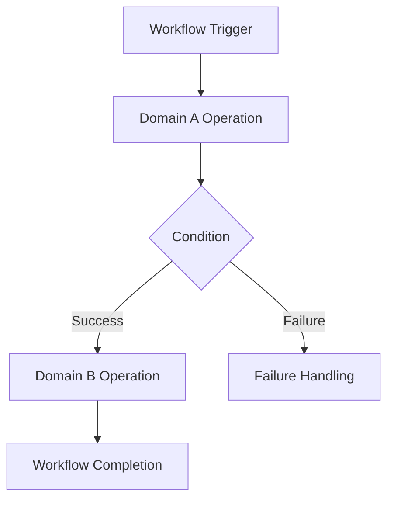

# `<Workflow Name>`

## 1. Overview

### 1.1 Workflow ID

`WF-<DOMAIN_OR_PROCESS>-<NUMBER>`

### 1.2 Goal

Describe the business outcome achieved by this workflow.

### 1.3 Description

Explain the end-to-end process, including the participating actors, domains and expected outcome.

### 1.4 Priority

- [ ] P0 — Critical
- [ ] P1 — High
- [ ] P2 — Medium
- [ ] P3 — Low

### 1.5 Specification Status

- [ ] Draft
- [ ] Under Review
- [ ] Approved
- [ ] Deprecated

---

## 2. Scope

### 2.1 In Scope

List the business activities and cross-domain interactions covered by this workflow.

### 2.2 Non-Goals

Identify activities that are outside the workflow.

### 2.3 Trigger

Describe the event, request or condition that initiates the workflow.

### 2.4 Completion Criteria

Define the conditions under which the workflow is considered successfully completed.

---

## 3. Actors and Participants

### 3.1 Human Actors

| Actor | Description | Responsibilities |
|---|---|---|
| `<Actor>` | `<Description>` | `<Responsibilities>` |

### 3.2 System Actors

| Actor | Description | Responsibilities |
|---|---|---|
| `<System / Agent>` | `<Description>` | `<Responsibilities>` |

### 3.3 Participating Domains

| Domain | Responsibility | Involvement |
|---|---|---|
| `<Domain>` | `<Responsibility>` | Initiator / Participant / Coordinator / Consumer |

Identify the authoritative domain for each business entity involved.

---

## 4. Preconditions

List the conditions that must be satisfied before the workflow can begin.

| ID | Precondition | Responsible domain |
|---|---|---|
| PRE-001 | `<Condition>` | `<Domain>` |

---

## 5. Workflow Sequence

Describe the workflow in execution order.

| Step | Responsible domain | Operation / capability | Input | Expected outcome |
|---|---|---|---|---|
| 1 | `<Domain>` | `<Operation>` | `<Input>` | `<Outcome>` |
| 2 | `<Domain>` | `<Operation>` | `<Input>` | `<Outcome>` |
| 3 | `<Domain>` | `<Operation>` | `<Input>` | `<Outcome>` |

Each operation should reference its corresponding feature specification where available.

### 5.1 Workflow Diagram

Insert a Mermaid sequence diagram or flowchart illustrating the interactions.

Replace the example with the actual workflow.

### 5.2 Decision Points

| Decision | Condition | Outcome |
|---|---|---|
| `<Decision>` | `<Condition>` | `<Outcome>` |

### 5.3 Parallel Operations

Identify operations that may execute concurrently.

| Operations | Dependency | Synchronization requirement |
|---|---|---|
| `<Operation A, Operation B>` | `<Dependency>` | `<Requirement>` |

---

## 6. Domain Responsibilities and Contracts

Describe the responsibility of each participating domain.

| Domain | Required capability | Contract / specification | Expected result |
|---|---|---|---|
| `<Domain>` | `<Capability>` | `<Feature specification>` | `<Result>` |

### 6.1 Domain Ownership

Identify which domain owns each business entity involved in the workflow.

| Entity | Owning domain | Accessing domains |
|---|---|---|
| `<Entity>` | `<Domain>` | `<Domains>` |

### 6.2 Cross-Domain Communication

Specify how participating domains interact.

- Synchronous requests.
- Asynchronous domain events.
- Commands.
- Queries.
- External integration calls.

Identify the expected communication mechanism and relevant contracts.

A workflow must not bypass domain ownership by directly modifying another domain's internal records.

---

## 7. State and Lifecycle

### 7.1 Workflow States

| State | Description |
|---|---|
| `<State>` | `<Description>` |

Suggested generic states, where applicable:

- Pending
- In Progress
- Awaiting Approval
- Completed
- Failed
- Cancelled
- Expired

### 7.2 State Transitions

| Current state | Trigger | Next state | Conditions |
|---|---|---|---|
| `<State>` | `<Trigger>` | `<State>` | `<Conditions>` |

### 7.3 Terminal States

Identify the states from which the workflow cannot continue.

---

## 8. Authorization and Security

### 8.1 Authorization Requirements

| Operation | Required actor | Required permission | Resource scope |
|---|---|---|---|
| `<Operation>` | `<Actor>` | `<Permission>` | `<Scope>` |

### 8.2 Agent Participation

If an AI agent participates in this workflow, specify:

- Agent principal and ownership.
- Delegation grant requirements.
- Permitted actions and resource scope.
- Tool authorization requirements.
- Human approval requirements.
- Credential and integration requirements.
- Behaviour when delegation is revoked during execution.

An agent must not inherit unrestricted authority from its human owner.

### 8.3 Security Constraints

Identify relevant access restrictions, sensitive data handling requirements and audit obligations.

---

## 9. Data Requirements

### 9.1 Required Data

| Data | Source domain | Purpose | Sensitivity |
|---|---|---|---|
| `<Data>` | `<Domain>` | `<Purpose>` | `<Classification>` |

### 9.2 Data Created or Modified

| Entity | Owning domain | Operation | Conditions |
|---|---|---|---|
| `<Entity>` | `<Domain>` | Create / Update / Read | `<Conditions>` |

### 9.3 Data Consistency

Specify:

- Required consistency guarantees.
- Eventual consistency expectations.
- Duplicate event handling.
- Idempotency requirements.
- Concurrent execution handling.
- Data reconciliation requirements.

---

## 10. Human-in-the-Loop

Identify where human intervention is required.

| Action | Approval required | Approver | Conditions |
|---|---|---|---|
| `<Action>` | Yes / No | `<Actor>` | `<Conditions>` |

### 10.1 Approval Lifecycle

Describe:

1. Approval request creation.
2. Approval notification.
3. Approval or rejection.
4. Expiration or cancellation.
5. Execution following approval.
6. Recording of the decision.

### 10.2 Timeout and Escalation

Specify the expected behaviour when approval is not received within the defined period.

If no human approval is required, explicitly state `None`.

---

## 11. Failure Handling and Recovery

Identify possible failure scenarios across the workflow.

| Failure | Responsible domain | Expected handling | Recovery |
|---|---|---|---|
| `<Failure>` | `<Domain>` | `<Handling>` | `<Recovery>` |

### 11.1 Retry Behaviour

Specify:

- Which operations are safe to retry.
- Maximum retry attempts, where defined.
- Backoff strategy, where defined.
- Idempotency requirements.
- Conditions requiring manual intervention.

### 11.2 Compensation

For workflows involving multiple state-changing operations, identify compensating actions.

| Completed operation | Failure condition | Compensating action |
|---|---|---|
| `<Operation>` | `<Condition>` | `<Action>` |

Do not assume that distributed operations can be rolled back as a single database transaction.

### 11.3 Partial Completion

Define how the system handles workflows where some operations succeed while others fail.

---

## 12. Notifications and Communications

Identify notifications or communications generated during the workflow.

| Trigger | Recipient | Channel | Responsible domain |
|---|---|---|---|
| `<Event>` | `<Recipient>` | `<Channel>` | `<Domain>` |

Distinguish between:

- Business events.
- Platform notifications.
- Human-to-human messages.
- Assistant-generated messages.

---

## 13. Domain Events

### 13.1 Events Consumed

| Event | Producer | Workflow response |
|---|---|---|
| `<Event>` | `<Domain>` | `<Response>` |

### 13.2 Events Published

| Event | Publishing domain | Trigger |
|---|---|---|
| `<Event>` | `<Domain>` | `<Trigger>` |

Specify relevant event ordering, duplicate handling and version compatibility requirements.

---

## 14. Gherkin Scenarios

### Scenario 1: Successful workflow completion

**Given** `<initial conditions>`

**And** `<required actors and permissions>`

**When** `<workflow trigger occurs>`

**Then** `<expected business outcome>`

**And** `<relevant domains complete their operations>`

### Scenario 2: Authorization failure

**Given** `<actor without sufficient authority>`

**When** `<restricted operation is attempted>`

**Then** `<operation is rejected>`

**And** `<unauthorized changes do not occur>`

### Scenario 3: Business rule violation

**Given** `<invalid business condition>`

**When** `<workflow is initiated>`

**Then** `<workflow is rejected or enters an appropriate state>`

### Scenario 4: External dependency failure

**Given** `<external dependency is unavailable>`

**When** `<dependent operation is attempted>`

**Then** `<failure is handled according to the recovery policy>`

### Scenario 5: Partial completion

**Given** `<some workflow steps have succeeded>`

**When** `<a subsequent step fails>`

**Then** `<the workflow enters the defined failure state>`

**And** `<compensation or recovery is performed where applicable>`

### Additional scenarios

Include relevant cases for:

- Duplicate workflow triggers.
- Concurrent workflow execution.
- Human approval rejection.
- Approval timeout.
- Revoked agent delegation.
- Expired credentials.
- Invalid domain events.
- Retry exhaustion.
- Cancellation.
- Partial completion.
- Recovery and resumption.

---

## 15. Observability and Auditability

Specify the information required to monitor and investigate workflow execution.

### 15.1 Execution Records

- Workflow ID.
- Workflow instance ID.
- Initiating actor.
- Participating domains.
- Execution timestamps.
- Current workflow state.
- Completed operations.
- Failed operations.
- Approval decisions.
- Correlation and causation identifiers.

### 15.2 Audit Requirements

Identify sensitive actions requiring audit evidence.

### 15.3 Monitoring

Specify relevant operational metrics:

- Workflow completion rate.
- Workflow failure rate.
- Average execution duration.
- Retry frequency.
- Approval waiting time.
- External dependency failures.

---

## 16. Non-Functional Requirements

| ID | Category | Requirement |
|---|---|---|
| NFR-001 | Performance | `<Requirement>` |
| NFR-002 | Reliability | `<Requirement>` |
| NFR-003 | Scalability | `<Requirement>` |
| NFR-004 | Security | `<Requirement>` |
| NFR-005 | Observability | `<Requirement>` |

Include measurable thresholds where known.

---

## 17. Acceptance Criteria

- [ ] Workflow starts under the specified conditions.
- [ ] All participating domains execute their defined responsibilities.
- [ ] Domain ownership boundaries are respected.
- [ ] Authorization is enforced at every relevant operation.
- [ ] Required business rules are satisfied.
- [ ] Domain events are processed correctly.
- [ ] Human approvals are handled correctly, where applicable.
- [ ] Failures and retries follow the defined recovery policy.
- [ ] Partial completion is handled correctly.
- [ ] Required audit evidence is recorded.
- [ ] All applicable Gherkin scenarios pass.
- [ ] Integration tests verify the end-to-end workflow.

Additional workflow-specific acceptance criteria:

- [ ] `<Acceptance criterion>`

---

## 18. Testing Requirements

### 18.1 Domain Integration Tests

Verify interactions between participating domains.

### 18.2 End-to-End Tests

Verify the complete workflow from trigger to terminal state.

### 18.3 Failure and Recovery Tests

Verify retry, compensation, timeout and recovery behaviour.

### 18.4 Authorization Tests

Verify permissions, ownership, delegation and approval requirements.

### 18.5 Concurrency Tests

Verify duplicate triggers, concurrent operations and state consistency.

---

## 19. Dependencies and Related Specifications

| Specification | Type | Relationship |
|---|---|---|
| `<Specification>` | Feature / Domain / Workflow | `<Relationship>` |

---

## 20. Open Questions

| ID | Question | Impact | Resolution |
|---|---|---|---|
| Q-001 | `<Question>` | `<Impact>` | Pending |

---

## 21. Implementation Notes

Optional section for approved architectural or technical constraints.

Do not use this section to replace domain contracts, feature specifications or workflow requirements.

---

## 22. Change History

| Version | Date | Changes | Author |
|---|---|---|---|
| 0.1 | `<Date>` | Initial draft | `<Author>` |